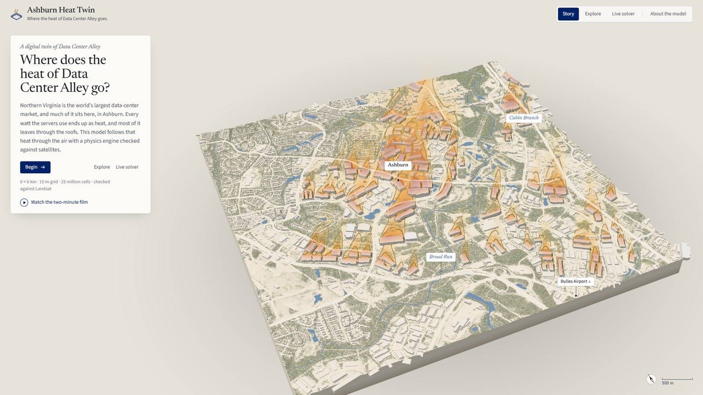

# Ashburn Heat Twin

**Where the heat of Data Center Alley goes.** This is a physics-based digital twin of data-center heat in Ashburn, Loudoun County, Virginia. It has a three-dimensional lattice-Boltzmann solver over real terrain and buildings, checked against Landsat, and a live WebGPU version that runs in the browser.

**[Open the platform →](https://alanhuang116.github.io/ashburn-heat-twin/)** · [Watch the two-minute film](https://alanhuang116.github.io/ashburn-heat-twin/media/ashburn-heat-twin.mp4)



Northern Virginia is the world’s largest data-center market. This project rebuilds a 6 × 6 km block of Ashburn from public data:

- USGS 3DEP terrain;
- NAIP 2023 aerial imagery;
- 4,037 building footprints, 211 of which are data centers on 54 campuses.

A GPU fluid solver then follows the heat that leaves the data-center roofs through the afternoon boundary layer.

## Three ways in

| Mode | What it shows |
|---|---|
| **Story** | Six short chapters: the place, the heat, the physics, the satellite check, three siting scenarios, and the live solver. |
| **Explore** | The archived 10 m runs. Layers include near-ground warming, the 3-D warm-air volume, streamlines, wind and the Landsat comparison. Click any data center to see the warming that campus causes on its own. |
| **Live solver** | The same lattice-Boltzmann kernel ported to WebGPU on a 20–40 m grid. Change the wind and the rooftop heat, or place a new 120 MW campus anywhere. |

## The model

- **Flow.** A D3Q19 lattice Boltzmann model with a regularized BGK collision.
  - Turbulence closures: Smagorinsky large-eddy closure (C<sub>s</sub> = 0.16) plus a Holtslag–Boville K-profile eddy viscosity for the daytime convective boundary layer.
  - Terrain and buildings are solid cells with half-way bounce-back.
  - The first air layer has a log-law surface drag, with roughness taken from ESA WorldCover.
- **Heat.** The potential-temperature anomaly θ is carried by a D3Q7 lattice Boltzmann advection–diffusion equation (turbulent Prandtl number 0.7). It feeds back on the flow through Boussinesq buoyancy, F<sub>z</sub> = ρgθ/T<sub>0</sub>, applied with Guo forcing.
- **Sources.** Rooftop heat rejection enters the first air cell above each operational data-center roof. The archived runs use 400 W per m² of roof, about 743 MW in the box.
- **Boundaries.**
  - Inflow: the wind observed at Washington Dulles (KIAD) at the Landsat overpass, with a power-law profile.
  - Outflow: a pressure outlet with a viscous sponge.
  - Top: a free-slip lid with an absorbing layer.
- **Grid.** 600 × 600 × 64 cells at 10 m (23 million cells), run on one GPU at about 950 million cell updates per second.

## Checks

- **Landsat 8/9 surface temperature.** The model was fitted on two days with opposite winds (30 Jul 2023 and 16 Jul 2024).
  - Calibration days: R² 0.86 and 0.84.
  - Held-out day (25 Aug 2024): R² 0.81, RMSE 1.36 °C.
  - The simulated downwind plume is not detectable in Landsat. This bounds the rooftop heat that reaches the ground-level air at roughly 380–400 W/m² of roof (one-sided 95%).
- **Solver budgets.** Mass imbalance is 0.2%. Heat leaving the box over heat injected is 0.92–0.98.
- **Browser solver.** The WebGPU port matches the numba/CUDA reference on the same 30 m grid.
  - Single steps agree to float precision (relative L2 ≤ 3.5 × 10⁻⁶ in θ).
  - The 10-minute mean near-ground warming has a relative error of 4.3 × 10⁻⁵, with peak 2.2745 K in both.
  - The heat budget closes to 98.6 %.
  - Speed is about 4,100 million cell updates per second at 30 m on an RTX 4090, against about 570 for the numba kernel on the same grid.
  - Two switchable safeguards keep it stable across the whole range of the controls: backflow-blocking outlets, and a flow restart after sharp wind turns.
  - Details: [`js/live/README.md`](js/live/README.md).

## Run it locally

```bash
git clone https://github.com/alanhuang116/ashburn-heat-twin.git
cd ashburn-heat-twin
python -m http.server 8000      # or any static server
# open http://localhost:8000
```

Requirements:

- **The model:** WebGL 2.
- **The live solver:** WebGPU (recent Chrome or Edge on desktop, or Safari 26).

There is no build step. The app is plain ES modules with a vendored three.js r160.

## Repository

```
index.html, css/, js/      the platform (three.js scene, story, explore, live mode)
js/live/                   WebGPU solver: WGSL generated from the reference kernel, domain builder, host
data/                      packed inputs and archived 10 m runs (about 17 MB), described in data/manifest.json
tools/pack_web.py          rebuilds data/ from the prototype's inputs and solver output
tools/live/, tests/live/   packing and validation of the browser solver against the reference
media/                     the two-minute film
```

## Limits

- Daytime, convective conditions only. There are no night-time inversions, no moisture and no evaporative-cooling plumes.
- Heat is assumed to leave as sensible heat at roof level, which is an upper bound for sites with evaporative cooling.
- There is no facility power data. All operational roofs share one flux. Campus numbers are arbitrary groupings, and operators are not identified.
- Some data-center heights are assumed (14 m where the footprint height estimate was implausible). Land cover is the 2021 map.
- This is a research prototype for exploring siting questions, not an environmental assessment of any facility.

## Data and licences

| Data | Licence |
|---|---|
| USDA NAIP 2023 orthoimagery | public domain |
| USGS 3DEP 1/3 arc-second DEM | public domain |
| Landsat 8/9 Collection 2 Level-2 surface temperature (USGS) | public domain |
| ESA WorldCover 2021 v200 | CC BY 4.0 |
| Microsoft Global ML Building Footprints | ODbL 1.0 |
| OpenStreetMap (data-center tags, waterways, roads, places) | ODbL 1.0, © OpenStreetMap contributors |
| KIAD ASOS observations (Iowa Environmental Mesonet) | public |
| ERA5 boundary-layer height (Open-Meteo) | CC BY 4.0 |

The derived building and OSM layers in `data/` remain under the ODbL. Code is MIT-licensed (see `LICENSE`). Fonts (Newsreader, Source Sans 3, Barlow) are under the SIL Open Font License. three.js is MIT-licensed.

## Credits

Xiao Huang, Department of Environmental Sciences, Emory University.

> Huang, X. (2026). *Ashburn Heat Twin: a lattice-Boltzmann digital twin of data-center heat in Loudoun County, Virginia.* https://github.com/alanhuang116/ashburn-heat-twin
